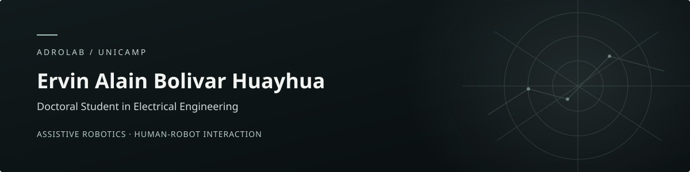

# Ervin Alain Bolivar Huayhua

Doctoral student in Electrical Engineering at the **Universidade Estadual de Campinas (UNICAMP)**, Brazil, and member of [AdRoLab — Advanced Robotics Laboratory](https://almada.dca.fee.unicamp.br/adrolab/).

## Research interests

Assistive Robotics · Human-Robot Interaction · Internet of Robotic Things (IoRT) · Multi-Agent Systems · Large Language Models · Semantic Sensing (SSN/SOSA) · IoT

## Recognition

**First place — PhyRC Challenge 2025**, organized by EmPRISE Lab, Cornell University, and sponsored by Kinova. The AdRoLab (UNICAMP) + H.IAAC team developed a hybrid approach using a Gaussian Mixture Model (GMM) for robotic dressing. The final stage took place at IEEE ICRA 2025.

## Education

- **Doctorate in Electrical Engineering**, UNICAMP · 2024–present
- **Master's in Electrical Engineering**, UNICAMP · 2023–2025
- **Electronic and Telecommunications Engineer**, Universidad Católica San Pablo (UCSP), Arequipa, Peru · 2014–2021

## Publications and research

- **2025** · [Context-Aware IoT Smart Hub: A Semantic and Cognitive Architecture for Adaptive Internet of Robotic Things Environments](https://doi.org/10.1109/SIoT68426.2025.11368775) · IEEE SIoT 2025
- **2025** · [RD-GMM: A GMM-Based Framework for Robotic Dressing with a Single Fixed Robotic Arm Applied to T-Shirt Wearing](https://doi.org/10.1109/SBR/WRE66973.2025.11249651) · IEEE SBR/WRE 2025
- **2025** · [Integração de LLMs na otimização e planejamento de sistemas multiagentes IoRT e interação conversacional](https://doi.org/10.47749/t/unicamp.2025.1518574) · Master's dissertation, UNICAMP
- **2024** · [IoRT multi-agent for assistive homes: First Test](https://doi.org/10.5281/zenodo.15048073) · BRAINN / Zenodo
- **2024** · [Robotic Structuring of an Assistive Home: Experimental Test](https://doi.org/10.5281/zenodo.15047999) · BRAINN / Zenodo
- **2024** · [Emotive Gestural Expressions for Assistive Home Humanoid Robots: Simulation Test](https://doi.org/10.5281/zenodo.15048001) · BRAINN / Zenodo
- **2024** · [Enhancing Assistive Home Environments through IoRT Multi-Agent Interaction: Model Selection and Robotic Operations](https://doi.org/10.5281/zenodo.15047997) · BRAINN / Zenodo

## Connect

[ORCID · 0009-0002-9626-3413](https://orcid.org/0009-0002-9626-3413) · [Lattes · 1692285115716301](http://lattes.cnpq.br/1692285115716301) · [Scopus Author ID · 60381836300](https://www.scopus.com/authid/detail.uri?authorId=60381836300)

[LinkedIn](https://www.linkedin.com/in/ervin-bolivar-h-b348b8137/) · [GitHub](https://github.com/EAI-IA) · [Email](mailto:e250091@dac.unicamp.br)
